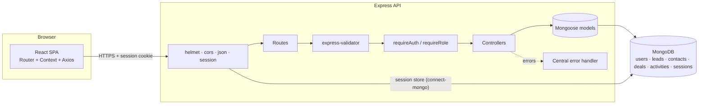
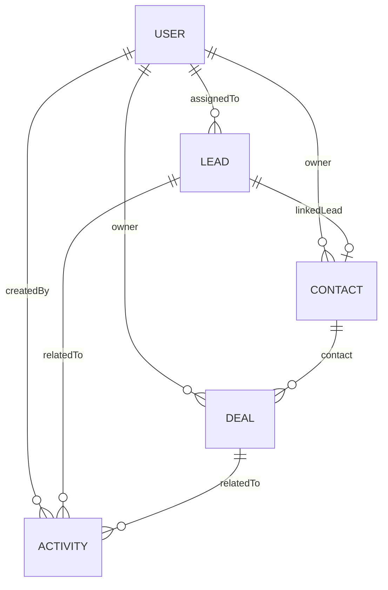

# ClientHub – MERN CRM

Full-stack CRM for managing **leads, contacts and a sales pipeline** with **role-based access control**,
follow-up tracking and a reporting dashboard. Built with the MERN stack and session-based authentication.

> Portfolio project. The focus is clean architecture, readable code and documentation rather than feature bloat.

## Features

- **Session authentication** – login / logout / current session, bcrypt-hashed passwords, httpOnly cookie, sessions stored in MongoDB. No public sign-up; admins create users.
- **Role-based access control** – `admin` sees everything and manages users and reassignment; `sales_exec` can only see and edit records assigned to them. Enforced in Express middleware and in every query, mirrored in the UI.
- **Lead management** – CRUD, search by name/company, filter by status and source, pagination, and one-click **convert lead → contact + deal**.
- **Contacts** – CRUD with search, optional link back to the originating lead.
- **Sales pipeline** – Kanban board (drag-and-drop *and* stage dropdown) plus a table view; values in INR.
- **Activities & follow-ups** – log calls, emails, meetings and notes against leads or deals; a "pending follow-ups" list of everything due today or overdue.
- **Dashboard** (Recharts) – open pipeline value, deals by stage (bar), conversion rate, leads by source (pie), pending follow-ups. Team-wide for admins, personal for sales execs.
- **Robust API** – express-validator validation, centralised error middleware, consistent `{ success, data, message }` responses and proper HTTP status codes.
- **Polished UI** – responsive sidebar layout, loading and empty states, toast notifications.

## Tech stack

| Layer | Technology |
| --- | --- |
| Frontend | React (Vite), React Router, Axios, Tailwind CSS, Recharts, react-hot-toast |
| Backend | Node.js, Express 5 |
| Database | MongoDB with Mongoose |
| Auth | express-session + connect-mongo (sessions), bcrypt |
| Validation | express-validator (API), hand-written form validation (UI) |
| Testing | Jest, Supertest, mongodb-memory-server |
| Tooling | ESLint, Prettier, dotenv, Git |

## Architecture



Backend follows MVC: `models/` (schemas), `controllers/` (business logic), `routes/` (URL → controller + middleware), `middleware/` (auth, validation, errors), `config/` (DB, session) and `utils/` (ApiError, response helper, ownership scoping).

### Entity relationships



## Project structure

```
clienthub/
├── client/                 React app (Vite)
│   └── src/ api · components · context · pages · utils
├── server/                 Express API
│   ├── config/ controllers/ middleware/ models/ routes/ utils/
│   ├── seed/seed.js        demo data
│   └── tests/              Jest + Supertest
└── docs/
    ├── functional-spec.md
    ├── api-docs.md
    └── ClientHub.postman_collection.json
```

## Getting started

### Prerequisites
- Node.js 20+
- MongoDB – a local instance **or** a free [MongoDB Atlas](https://www.mongodb.com/atlas) cluster

### 1. Install
```bash
git clone https://github.com/akshatkumar04/clienthub-crm.git
cd clienthub-crm
npm run install:all        # installs server/ and client/ dependencies
```

### 2. Configure environment
```bash
cp server/.env.example server/.env
cp client/.env.example client/.env      # optional in development
```
Edit `server/.env` (never commit it):

| Variable | Description |
| --- | --- |
| `PORT` | API port (default `5000`) |
| `MONGODB_URI` | e.g. `mongodb://127.0.0.1:27017/clienthub` or your Atlas `mongodb+srv://…` string |
| `SESSION_SECRET` | Long random string used to sign the session cookie |
| `CLIENT_URL` | Origin of the React app for CORS (default `http://localhost:5173`) |
| `NODE_ENV` | `development` / `production` (production enables secure cookies) |
| `DNS_SERVERS` | Optional, e.g. `8.8.8.8,1.1.1.1`. Fixes `querySrv ECONNREFUSED` with Atlas `mongodb+srv://` URIs on networks whose DNS refuses SRV lookups |

`client/.env`: `VITE_API_URL` – defaults to `/api`, which Vite proxies to `http://localhost:5000` in development.

### 3. Seed demo data
```bash
npm run seed
```
> ⚠️ The seed script **deletes** existing users, leads, contacts, deals and activities before inserting demo data. It creates 1 admin, 2 sales executives, 30 leads, 15 contacts, 20 deals and 25 activities with Indian company and person names.

### 4. Run
```bash
npm run server     # API on http://localhost:5000
npm run client     # React app on http://localhost:5173   (second terminal)
```

### Demo credentials (from the seed script)

| Role | Email | Password |
| --- | --- | --- |
| Admin | `admin@clienthub.in` | `Password@123` |
| Sales Executive | `kavya@clienthub.in` | `Password@123` |
| Sales Executive | `rohan@clienthub.in` | `Password@123` |

Log in as an exec and as the admin to see how the dashboard, leads and pipeline scope change.

## Testing

```bash
npm test
```
Runs Jest + Supertest against an in-memory MongoDB (`mongodb-memory-server`, no setup required; the first run downloads a MongoDB binary). Covered: login/logout/session, bcrypt hashing, admin-only user management, RBAC (e.g. a sales exec cannot read, edit, move or delete another user's deal), reassignment rules, search/filter/pagination, lead conversion, pending follow-ups and dashboard aggregation per role.

## API documentation

- [`docs/api-docs.md`](docs/api-docs.md) – all **32 endpoints** with access level, request bodies and example responses
- [`docs/ClientHub.postman_collection.json`](docs/ClientHub.postman_collection.json) – import into Postman. Log in first; the cookie jar keeps the session and create-requests store ids in collection variables.
- [`docs/functional-spec.md`](docs/functional-spec.md) – problem statement, roles, user stories, requirements and sales workflow

## Screenshots

> Add screenshots after running the seed script. Suggested paths: `docs/screenshots/`.

| Dashboard | Leads |
| --- | --- |
|  |  |

| Pipeline (Kanban) | Activities & follow-ups |
| --- | --- |
|  |  |

## Design decisions

- **Sessions over JWT** – the app is a first-party web client, so an httpOnly cookie with a server-side session is simpler and safer (no token in `localStorage`, instant revocation on logout, role changes apply immediately because the user is loaded per request).
- **Ownership scoping in the query layer** – `scopeFor(user, ownerField)` is merged into every filter, so a sales exec physically cannot fetch another user's records; out-of-scope records return `404` rather than `403` to avoid leaking their existence.
- **Aggregation pipelines for the dashboard** – `$match` (scoped) → `$group` runs inside MongoDB instead of loading documents into Node.

## Scripts

| Command (repo root) | Purpose |
| --- | --- |
| `npm run install:all` | Install server and client dependencies |
| `npm run server` / `npm run client` | Start API / React dev server |
| `npm run seed` | Reset and seed demo data |
| `npm test` | Backend tests |
| `npm run lint` | ESLint for server and client |

## License

MIT
