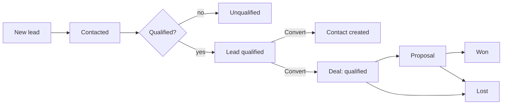

# ClientHub – Functional Specification

## 1. Problem statement

Small and mid-sized sales teams often track leads in spreadsheets and chat threads. Follow-ups get
missed, nobody knows who owns which prospect, and managers cannot see the state of the pipeline
without asking around.

**ClientHub** is a lightweight CRM that gives a sales team a single place to:

- capture and qualify **leads**,
- keep a directory of **contacts**,
- move **deals** through a sales pipeline,
- log **activities** and never miss a **follow-up**, and
- see team or personal performance on a **dashboard**.

Access is role based, so sales executives focus on their own book of business while admins keep
visibility over the whole team.

## 2. User roles

| Role | Description | Data access |
| --- | --- | --- |
| **Admin** | Sales manager / account owner. The first admin is created by the seed script. | Full access to every lead, contact, deal and activity. Manages users. Can reassign leads, contacts and deals. |
| **Sales Executive** (`sales_exec`) | Day-to-day salesperson. Created by an admin. | Can only view and edit records **assigned to / owned by them**. Cannot manage users or reassign records. |

### Permission matrix

| Capability | Admin | Sales Exec |
| --- | :---: | :---: |
| Log in / log out / view own session | ✅ | ✅ |
| Create, edit, delete users | ✅ | ❌ |
| View leads, contacts, deals, activities | all | own only |
| Create / edit / delete leads, contacts, deals | all | own only |
| Reassign owner of a lead / contact / deal | ✅ | ❌ (owner is always themselves) |
| Convert a lead to contact + deal | all | own only |
| Dashboard | team-wide | personal |

## 3. User stories

### Authentication
- As a user, I can log in with my email and password so that I can access the CRM.
- As a user, I can log out so that nobody else can use my session.
- As an admin, I can create accounts for my sales executives, because there is no public sign-up.
- As an unauthenticated visitor, I am redirected to the login page when I open a protected page.

### Leads
- As a sales exec, I can add a lead with contact details, source and notes.
- As a sales exec, I can search leads by name or company and filter by status and source.
- As a sales exec, I can page through a long list of leads.
- As a sales exec, I can convert a qualified lead into a contact **and** a deal in one click.
- As an admin, I can reassign a lead to another sales executive.

### Contacts
- As a sales exec, I can store and search the people I deal with, including their designation.

### Pipeline
- As a sales exec, I can see my deals as a Kanban board grouped by stage.
- As a sales exec, I can move a deal between stages (dropdown or drag-and-drop).
- As a sales exec, I can switch to a table view to scan values and close dates.

### Activities and follow-ups
- As a sales exec, I can log a call, email, meeting or note against a lead or deal.
- As a sales exec, I can set a follow-up date and see everything due today or overdue in one list.
- As a sales exec, I can mark a follow-up as completed.

### Dashboard
- As a sales exec, I can see my open pipeline value, deals by stage, conversion rate, leads by source
  and pending follow-ups.
- As an admin, I see the same numbers aggregated over the whole team.

## 4. Feature requirements

| # | Feature | Requirements |
| --- | --- | --- |
| F1 | Authentication | Session-based login (cookie + server-side session in MongoDB), logout, current-session endpoint, bcrypt-hashed passwords, no public registration. Protected routes on both API and UI. |
| F2 | RBAC | Role check middleware for admin-only routes. Ownership scoping on every query so execs only touch their own records. Out-of-scope records respond `404`. |
| F3 | Leads | CRUD, search by name/company, filter by status and source, pagination, convert-to-contact+deal. |
| F4 | Contacts | CRUD, search by name/company/email, optional link back to the originating lead. |
| F5 | Pipeline | Deals with INR value, stage and expected close date. Kanban board with stage dropdown (and simple drag-and-drop), plus table view. |
| F6 | Activities | Log call/email/meeting/note against a lead or deal, optional follow-up date, completion flag, "pending follow-ups" list (due today or overdue). |
| F7 | Dashboard | Open pipeline value, deals by stage (bar), conversion rate, leads by source (pie), pending follow-ups count. Scoped by role. |
| F8 | Error handling | Central Express error middleware, consistent `{ success, data, message }` envelope, correct HTTP status codes. |
| F9 | UI | Responsive layout with sidebar (Users link for admins only), loading states, empty states, toast notifications. |

### Business rules

- A lead's owner is `assignedTo`; a contact's and deal's owner is `owner`; an activity's owner is `createdBy`.
- Execs always own what they create. Only admins can set a different owner.
- A deal must reference a contact the creator can access.
- A lead can be converted only once. Conversion creates a contact (copying name, company, email,
  phone, linked back to the lead) and a deal in the **qualified** stage, and sets the lead's status
  to **qualified**.
- Pipeline value counts only **open** deals (`new`, `qualified`, `proposal`).
- Conversion rate = `won / (won + lost)`; it is `0` when there are no closed deals.
- A follow-up is "pending" when `completed = false` and `followUpDate` is today or earlier.
- A user who still owns leads, contacts or deals cannot be deleted; reassign first. The last admin
  cannot be demoted and users cannot delete themselves.
- Deleting a lead or deal also deletes its activities. A contact with deals cannot be deleted.

## 5. Sales workflow

1. **Lead captured** (`new`) from a website form, referral, cold call, event or elsewhere.
2. The exec reaches out and logs activities; the lead becomes **contacted**.
3. After discovery the lead is **qualified** or **unqualified**.
4. A qualified lead is **converted**: a contact and a deal are created and the deal starts in the
   **qualified** stage.
5. The deal moves **qualified → proposal → won / lost**. (Deals created directly can also start in `new`.)
6. Throughout, follow-up dates keep the pipeline moving; overdue items surface on the dashboard
   and the Activities page.

## 6. Data model summary

| Entity | Key fields |
| --- | --- |
| User | name, email (unique), password (bcrypt hash), role, createdAt |
| Lead | name, company, email, phone, source, status, assignedTo → User, notes, createdAt |
| Contact | name, company, email, phone, designation, linkedLead → Lead (optional), owner → User |
| Deal | title, value (INR), stage, contact → Contact, owner → User, expectedCloseDate, createdAt, updatedAt |
| Activity | type, description, relatedTo { kind: Lead\|Deal, item }, followUpDate, completed, createdBy → User |

## 7. Out of scope

Email integration, file attachments, multi-currency, audit trail, public sign-up, password reset,
and real-time collaboration. The project intentionally stays small and readable.
